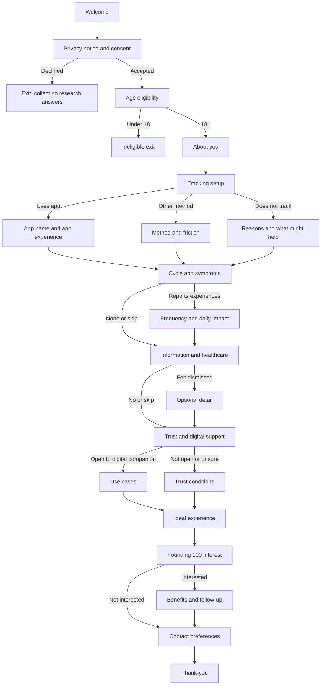

# Nivaari — Founding 100 Research Form
## Question bank, branching logic, data model, privacy requirements and Antigravity build brief

**Purpose:** Discover the real menstrual-health and everyday wellbeing problems women want solved before deciding what Nivaari should build.  
**Audience:** Women aged 18+.  
**Target completion time:** 8–12 minutes, depending on the participant's answers.  
**Survey version:** `founding_100_v1`

---

## 1. What we are building

A mobile-first, conversational research form. It should feel like a thoughtful conversation, not a long medical questionnaire. It must adapt to each participant: answers determine which relevant follow-up questions appear.

Research objectives:
1. Understand current period-tracking habits and unmet needs.
2. Learn which symptoms and experiences affect everyday life.
3. Understand where women seek information and support.
4. Identify barriers to reliable, affordable, respectful healthcare.
5. Understand digital-health trust and privacy expectations.
6. Learn which kinds of support women would actually use.
7. Invite interested participants to the Nivaari Founding 100 programme.

This is research, not diagnosis, treatment, medical triage, or proof of product-market fit. Do not infer a condition from answers or provide medical advice.

## 2. Experience principles

- One clear question per screen, or a small group of closely related questions.
- Conversational, neutral, non-judgemental language.
- Optional answers for sensitive topics; include “Prefer not to say” where appropriate.
- “Other” opens a short text field.
- “None of these” is mutually exclusive with other multi-select options.
- Back navigation is supported. If an earlier answer changes, recalculate the path and clear answers to questions that are no longer applicable.
- Use adaptive section progress rather than a fixed question count.
- No pressure to join the Founding 100 or share health information.
- Mobile-first, accessible, readable, and usable with keyboard and screen readers.
- Avoid slang, clinical jargon, leading questions, and assumptions about gender identity, relationships, fertility, or diagnoses.

## 3. Participant journey

1. Welcome and purpose.
2. Privacy notice and consent.
3. Age eligibility (18+).
4. About the participant.
5. Current tracking setup.
6. Cycle experience and symptoms.
7. Everyday impact.
8. Information sources and healthcare experiences.
9. Trust, privacy, and digital support.
10. Ideal Nivaari experience.
11. Founding 100 interest.
12. Separate contact preferences and contact details.
13. Thank-you screen.

### Welcome screen copy

**Your experience matters. Help us build a better kind of women's health support.**

We're building Nivaari to help women understand their menstrual health, make sense of recurring experiences, and find reliable support without judgement.

We don't want to assume what women need. We want to listen first. Your honest feedback will help shape what we build.

We're inviting 100 women to help shape Nivaari from the beginning. Participants selected for the Founding 100 programme will receive the benefits described in the programme terms, including lifetime free access to the defined core product.

**Start the conversation**

Estimated time: 8–12 minutes. You can skip optional questions and leave at any time.

---

## 4. Privacy, consent and eligibility

### Important

Do not promise “100% security”, “nobody else can see your data”, or “only five people can read your answers” unless the complete technical and operational setup has been verified. A women-led team is a meaningful brand commitment, but team composition alone does not guarantee privacy.

Before launch, publish a reviewed privacy notice identifying:
- The organisation responsible for the data and a privacy contact.
- Data collected and the purpose for each category.
- Who can access identifiable information and why.
- Hosting, analytics, email, and other third-party processors.
- Storage location and any international transfers/access.
- Retention and deletion periods.
- How participants can withdraw consent or request access, correction, or deletion as applicable.
- Whether data is used for analytics, AI development, or model training. Default: do not use identifiable research responses to train AI models.

The intended human review group may include one psychologist, one gynaecologist, one dietitian, and two founders. Use role-based access and pseudonymised responses wherever possible. Do not imply all five people routinely read every identifiable response.

### Draft consent copy — must be reviewed before launch

**Your information is personal. We will treat it with care.**

This study asks about menstrual health, wellbeing, and experiences seeking support. Some answers may be sensitive. Participation is voluntary. You may skip optional questions or stop at any time.

Your responses will be used to understand needs and guide Nivaari's research and product development, as described in the Nivaari Privacy Notice. We will separate contact details from research answers wherever reasonably possible. Access to identifiable information will be restricted to authorised people who need it for the stated purposes. We will not sell your personal or health information or use it for targeted advertising.

Please read the Privacy Notice for details about service providers, storage, access, retention, and your choices. No online service can guarantee absolute security.

### Separate consent controls

Use separate, unchecked checkboxes:
- `consent_age`: I confirm I am 18 years or older.
- `consent_research`: I have read the research information and voluntarily agree to participate.
- `consent_sensitive_data`: I understand that some questions may involve sensitive health-related information and consent to its processing for the purposes described in the Privacy Notice.
- `consent_contact`: Optional — I agree to be contacted about the Founding 100 programme.
- `consent_updates`: Optional — I agree to receive occasional Nivaari updates.

Do not bundle research consent and marketing consent. If under 18, stop without collecting health answers. If required consent is declined, do not collect research responses.

---

## 5. Question bank and branching

Question IDs are stable identifiers. Do not rename them after launch; analytics depend on them. Sensitive questions should generally be optional.

### A — About you

**A01. Which age range do you belong to?** (`single_select`, required)  
18–20; 21–24; 25–29; 30–34; 35–39; 40–44; 45+; Prefer not to say.

**A02. Which best describes your current routine?** (`single_select`, optional)  
Student; Working full-time; Working part-time; Freelancer/self-employed; Homemaker; Not currently working; Other; Prefer not to say.

**A03. Which city or town do you live in?** (`short_text`, optional)  
Helper: City or town only. Do not enter a full address.

**A04. Which option comes closest to your current menstrual-cycle experience?** (`single_select`, required)  
- My periods are generally predictable.
- They vary a little from month to month.
- They are often unpredictable.
- I do not currently get periods.
- My periods have changed recently.
- I'm not sure.
- Prefer not to say.

Branch: predictable → B01. Vary/unpredictable/recent change → A05 then B01. Do not currently get periods → A06 then relevant common sections. Not sure/prefer not → skip detailed regularity follow-up.

**A05. If your cycle is unpredictable, what best describes your experience?** (`multi_select`, optional)  
Days between periods vary; period arrives earlier/later than expected; sometimes miss a period; bleeding duration changes; flow changes significantly; recent change; not sure how to describe it; prefer not to say.

**A06. Would you like to share why you do not currently get periods?** (`multi_select`, optional)  
Pregnancy or recent childbirth; breastfeeding; menopause/perimenopause; hormonal contraception or other medication; a health condition or treatment; another reason; would rather not say.  
Do not infer or require a diagnosis.

### B — Current tracking setup

**B01. How do you currently keep track of your period, if at all?** (`single_select`, required)  
Period-tracking app; phone calendar; notes/diary; remember mentally; do not track; another method.

Branch:
- App → B02 → B03 → B04 → B05.
- Calendar/notes/memory → B03 → B04 → B05.
- Do not track → B06 → B07 → C01.

**B02. Which period-tracking app or apps have you used?** (`short_text`, optional)

**B03. What made you choose this way of tracking?** (`multi_select`, optional)  
Easy to use; accurate enough; recommended by someone; helps me understand my cycle; free/affordable; privacy feels acceptable; came with phone/device; always used it; other.

**B04. What, if anything, frustrates you about your current method?** (`multi_select`, optional)  
Predictions not reliable; too much manual entry; too many notifications; confusing information; too many paywalls; privacy concerns; design/language does not feel right; does not help explain symptoms; nothing in particular; other.

**B05. Have you stopped using a tracking app or considered switching?** (`single_select`, optional)  
Stopped using one; considered switching; switched before; happy with current method; never used a tracking app.  
Branch: stopped/considered/switched → B08; otherwise → C01.

**B06. What are the main reasons you do not track your cycle?** (`multi_select`, optional)  
Don't feel I need to; forget; too much effort; cycle too unpredictable; privacy concerns; don't know what to track; haven't found a tool I like; other.

**B07. What might make tracking useful or easier?** (`multi_select`, optional)  
Quick check-ins; helpful reminders; better explanations of patterns; understandable privacy controls; simple calendar; qualified professional support; not interested in tracking; other.

**B08. What would a new app need to do better for you to consider using it?** (`long_text`, optional)

### C — Symptoms and everyday impact

**C01. Which experiences do you notice around your period or at different points in your cycle?** (`multi_select`, optional)  
Cramps/pelvic pain; bloating; headaches; skin changes/acne; breast tenderness; fatigue/low energy; mood changes; anxiety/irritability; appetite or food-craving changes; sleep changes; heavy bleeding; changes in discharge; other; none of these; prefer not to say.

If “none of these” is selected, clear other selections and skip symptom-specific follow-ups.

**C02. How often do the experiences you selected affect you?** (`single_select`, optional)  
Rarely; some cycles; most cycles; nearly every day; varies; not sure.

**C03. How much do these experiences affect your everyday routine?** (`scale`, optional)  
1 = Not at all; 5 = A great deal.

**C04. Can you recall a recent time when a symptom or cycle-related change affected your plans? What happened?** (`long_text`, optional)  
Helper: Work, study, exercise, sleep, social plans, or daily activities. Share only what feels comfortable.

**C05. Do you notice changes in mood, energy, sleep, appetite, or focus during your cycle?** (`single_select`, optional)  
Yes, clearly; sometimes; suspect there may be a pattern; no; haven't paid attention.  
Branch: yes/sometimes/suspect → C06; no/not paid attention → C07.

**C06. Which changes have you noticed?** (`multi_select`, optional)  
Energy; mood; sleep; appetite; focus/productivity; exercise/physical performance; skin; social energy; other.

**C07. Do you change food, exercise, rest, or your schedule based on how you feel?** (`single_select`, optional)  
Yes, regularly; sometimes; only when symptoms are difficult; no, usually continue as normal; would like to but don't know what might help.

**C08. What is one thing about your body or menstrual health you wish you understood better?** (`long_text`, optional)

### D — Information and healthcare

**D01. Where do you usually go when you have a menstrual-health question?** (`multi_select`, optional)  
Gynaecologist/doctor; mother/sister/family; friends; Google/search; YouTube; Instagram; Reddit/online communities; AI tools; health or period apps; usually don't ask anyone; other.

**D02. How often do you come across health advice that is confusing or contradictory?** (`single_select`, optional)  
Very often; sometimes; rarely; never; not sure.

**D03. When you see a health tip online, how do you decide whether to trust it?** (`single_select`, optional)  
Check with a qualified professional; look for reliable medical sources; search for more opinions; ask family/friends; try it if it sounds reasonable; difficult to tell; other.

**D04. Have you ever felt uncomfortable, dismissed, or not taken seriously when discussing a health concern?** (`single_select`, optional)  
Yes; no; sometimes; prefer not to say.  
Branch: yes/sometimes → D05.

**D05. If comfortable sharing, what happened and what would have made the experience better?** (`long_text`, optional)

**D06. What can make it difficult to seek help when something feels wrong?** (`multi_select`, optional)  
Cost; finding a trustworthy professional; not knowing whether symptoms need attention; fear/embarrassment; family/social restrictions; previous negative experience; time/access; no particular barrier; other; prefer not to say.

**D07. If you could ask a qualified gynaecologist, psychologist, or dietitian one question, what would you ask?** (`long_text`, optional)  
Helper: This form is not for urgent medical concerns or personal medical advice.

### E — Trust and digital support

**E01. How comfortable would you feel recording menstrual-health information in a digital product?** (`scale`, optional)  
1 = Not comfortable; 5 = Very comfortable.

**E02. What would make you hesitant to use a women's health platform?** (`multi_select`, optional)  
Personal information shared; health information used for advertising; unclear privacy policy; someone else accessing account; inaccurate predictions; unqualified medical advice; too many notifications; feeling judged; nothing in particular; other.

**E03. Would access to qualified professionals be useful within a women's health platform?** (`single_select`, optional)  
Yes; maybe, depending on cost and availability; prefer self-guided information; no; not sure.

**E04. Which kinds of support would be most useful? Choose up to three.** (`multi_select`, optional)  
Personalised cycle tracking; understanding recurring symptoms; reliable hormonal-health education; nutrition/everyday-habit guidance; mental and emotional wellbeing resources; gynaecologist access; psychologist access; dietitian access; moderated women's community; reminders/check-ins; understanding when to seek medical attention; other.

**E05. How would you feel about a digital companion that helps explain health information and offers general, evidence-informed guidance?** (`single_select`, optional)  
Comfortable; open if its limits are clear; prefer a human; not comfortable; not sure.  
Branch: comfortable/open → E06; prefer human/not comfortable/unsure → E07.

**E06. If you used such a companion, what would you want to use it for?** (`multi_select`, optional)  
Understanding general health information; reflecting on symptom patterns; preparing questions for a doctor; everyday wellbeing suggestions; nutrition information; emotional-support resources; reminders/check-ins; would not discuss personal health details with AI; other.

**E07. What would a digital health product need to do for you to feel comfortable trusting it?** (`long_text`, optional)

### F — The ideal experience

**F01. Imagine a service that genuinely understands your needs. What is the one problem you would most want it to solve?** (`long_text`, optional)

**F02. What would you like a health app to help you remember, organise, or understand without lots of daily data entry?** (`long_text`, optional)

**F03. What would make you want to return to a women's health platform? Choose up to three.** (`multi_select`, optional)  
Useful personal insights; simple tracking; answers to questions I have; supportive check-ins; qualified professional access; safe moderated community; relevant offers/benefits; progress/milestones; calm welcoming experience; other.

**F04. What do you wish women's health products understood better about real women's lives?** (`long_text`, optional)

### G — Founding 100

**G01. Would you like to be considered for Nivaari's Founding 100 programme?** (`single_select`, optional)  
Yes; I'd like to learn more; not right now.  
Branch: yes/learn more → G02 and G03; not right now → skip to contact preferences.

**G02. Which benefits interest you?** (`multi_select`, optional)  
Lifetime free access to the defined core product; early feature access; influence product decisions; research feedback sessions; community access; discounts/partner offers; priority access to selected professional services; founding member recognition; other.

**G03. Would you be open to a short follow-up conversation with the research team?** (`single_select`, optional)  
Yes; maybe; no.

**G04. Is there anything else you'd like the Nivaari team to understand?** (`long_text`, optional)

### H — Contact details (keep separate from health responses)

Only show the relevant contact fields if the participant asks to be contacted or opts into the programme.

**H01. What name should we use when contacting you?** (`short_text`, conditional)

**H02. What email address can we use to contact you?** (`email`, conditional)

**H03. Would you like to share a mobile number for programme-related contact?** (`phone`, optional)  
Helper: Optional. Do not require a phone number unless there is a clear operational need.

**H04. May we contact you about the Founding 100 programme?** (`yes_no`, conditional)

**H05. Would you like occasional Nivaari product and research updates?** (`yes_no`, optional)  
Marketing updates must not be a condition of research participation or cohort consideration.

---

## 6. High-level branching map



The question IDs and conditions in this document are the implementation source of truth.

### Branching rules
- “None of these” clears other selections.
- “Other” reveals an optional text field.
- If an earlier answer changes, recompute the active path and remove no-longer-applicable answers from the active submission.
- Never require sensitive disclosure to proceed.
- Do not infer diagnoses or provide health recommendations.
- Do not silently keep hidden answers as current answers after a path changes.

---

## 7. Data model

Use stable question IDs and version the question configuration.

### `research_participants` — contact and consent metadata
- `id` UUID
- `created_at`
- `name` optional
- `email` optional
- `phone` optional
- `contact_permission` boolean
- `updates_permission` boolean
- `consent_version`
- `consented_at`
- `withdrawn_at` nullable

### `research_responses`
- `id` UUID
- `participant_id` nullable reference to separately protected contact record
- `survey_version`
- `status`: `in_progress`, `submitted`, `withdrawn`
- `started_at`
- `submitted_at`
- `consent_record_id`

### `research_answers`
- `id` UUID
- `response_id`
- `question_id`
- `answer_json`
- `answered_at`
- `question_version`

### `consent_records`
- `id` UUID
- `response_id` or protected participant reference
- `consent_type`
- `granted`
- `notice_version`
- `recorded_at`

Example answer payload:

```json
{
  "survey_version": "founding_100_v1",
  "response_id": "uuid",
  "answers": [
    {"question_id": "B01", "answer": "period_app"},
    {"question_id": "B02", "answer": ["Flo"]},
    {"question_id": "B04", "answer": ["too_many_notifications", "privacy_concerns"]}
  ]
}
```

### Data minimisation
Do not collect full date of birth, full address, government ID, medical reports, prescription photos, precise location, or partner/family details unless a separately justified need arises. Do not collect name, email, and phone just because the fields exist. Keep contact details separate from health answers.

---

## 8. Privacy and security requirements

These are launch requirements:
1. Enable Supabase Row Level Security (RLS) on every table exposed through the client API.
2. Never expose the Supabase service-role key or privileged secrets in frontend code.
3. Use a narrowly scoped server-side submission endpoint or constrained insert policy.
4. Participants must never be able to read another participant's responses.
5. Separate contact information from health-related answers and link only with a random internal identifier when necessary.
6. Restrict staff access by role and least privilege.
7. Use HTTPS and provider-supported encryption controls.
8. Do not use advertising pixels, session replay, or analytics that capture form inputs.
9. Never put answers, contact details, or health information in URLs, analytics events, or logs.
10. Define retention and deletion procedures before launch.
11. Record the privacy notice and consent version shown to each participant.
12. Do not use identifiable research responses to train AI models by default.
13. Review the privacy notice and consent flow with qualified legal/privacy professionals before launch.

---

## 9. Research analysis plan

Compare these groups:
- Uses a period app vs does not.
- Predictable vs variable/unpredictable cycles.
- Low vs high daily impact.
- Professional support vs informal/online information sources.
- Comfortable vs uncomfortable sharing data digitally.
- Interested vs not interested in professional access.
- Interested vs not interested in an AI companion.

Track:
- Starts, completions, and drop-off by question/section.
- Median completion time.
- Tracking methods and most common frustrations.
- Most common experiences and daily impacts.
- Information sources and barriers to care.
- Privacy concerns and trust levels.
- Top requested support needs.
- Founding 100 interest and follow-up opt-in rates.

Code open-text responses consistently:
`tracking_friction`, `prediction_accuracy`, `symptom_understanding`, `daily_impact`, `emotional_wellbeing`, `access_affordability`, `healthcare_experience`, `trust_privacy`, `information_overload`, `desired_support`, `other_unmet_need`.

De-identify quotes before internal sharing beyond the authorised research team. Do not publish participant quotes without explicit permission.

After 100 responses:
1. Identify the five most repeated problems.
2. Identify which groups experience each problem.
3. Separate frequent problems from severe but less frequent problems.
4. Conduct follow-up interviews with participants who separately opted in.
5. Select one initial problem to solve well.
6. Test a prototype and observe actual usage.
7. Treat stated interest as a hypothesis; use retention and repeated behaviour to test demand.

---

## 10. Antigravity implementation brief

Build the **research form only**. Do not build the full Nivaari tracker, AI companion, clinician booking system, or community in this task.

### Brand direction
Use Nivaari's established palette:
- Olive Green `#556B45`
- Sage Green `#A7C4A0`
- Peach Orange `#E8976B`
- Blush Pink `#E8A7A1`
- Warm Beige `#F4E1D4`
- Ivory White `#FDF6F2`
- Terracotta `#C87B5A`
- Forest Green `#2E3D2F`

Use warm ivory as the base, olive/forest green for readable text and primary actions, and peach/blush as restrained accents. Minimal, warm, modern, and reassuring. Avoid excessive gradients, glassmorphism, neon, medical-dashboard styling, and decorative clutter.

### Suggested stack
- React + TypeScript
- Tailwind CSS and the repository's existing component system
- Supabase
- Vercel
- GitHub

Inspect the existing repository first. Preserve working conventions and components; do not replace architecture unnecessarily.

### Functional requirements
1. Central, versioned survey configuration using the question IDs in this document.
2. A reusable question renderer for single-select, multi-select, text, scale, email, phone, and consent.
3. Branching engine separated from UI components.
4. One question or a small logical group per screen.
5. Back navigation and active-path recalculation.
6. Clear hidden answers when they are no longer applicable.
7. Optional question skipping.
8. “Other” conditional text input and mutually exclusive “None of these”.
9. Accessible validation and plain-language error states.
10. Adaptive section progress.
11. Review step before submission.
12. Secure submission and duplicate-submit protection.
13. Separate contact and research data.
14. Versioned consent record.
15. Thank-you and failure states.
16. No medical advice, diagnosis, symptom scoring, or automated triage.
17. No public research dashboard. Any internal dashboard must be a separate authenticated phase.

### Suggested project structure

```text
src/
  app/research/page.tsx
  app/research/thank-you/page.tsx
  components/research/
    ResearchShell.tsx
    WelcomeScreen.tsx
    ConsentScreen.tsx
    QuestionRenderer.tsx
    SingleSelectQuestion.tsx
    MultiSelectQuestion.tsx
    TextQuestion.tsx
    ScaleQuestion.tsx
    ProgressIndicator.tsx
    ReviewScreen.tsx
    ThankYouScreen.tsx
  config/founding100/
    survey.v1.ts
    branching.v1.ts
    copy.v1.ts
  lib/research/
    branching-engine.ts
    validation.ts
    answer-store.ts
    submission.ts
    consent.ts
  types/research.ts
  tests/
    branching-engine.test.ts
    consent.test.ts
    submission.test.ts
```

Adapt this to the repository's existing conventions.

### Required tests
- App users see app-specific questions; non-app users do not.
- Non-trackers see the reasons-for-not-tracking path.
- Participants selecting no symptoms do not see symptom-detail follow-ups.
- Participants reporting dismissal see the optional detail question.
- Participants not open to AI see trust-condition questions, not AI use-case questions.
- Under-18 participants cannot submit research answers.
- Declined consent creates no research response.
- Changing an earlier answer removes no-longer-applicable answers from the active submission.
- A participant cannot read another participant's record.
- Contact details are not exposed in research-answer queries.
- Repeated submission does not create duplicate completed records.

### Build order
1. Inspect repository and report its existing structure.
2. Build welcome and consent screens.
3. Implement typed survey configuration and question renderer.
4. Implement and unit-test branching engine.
5. Add answer state, back navigation, and path recalculation.
6. Add validation and accessibility.
7. Add Supabase schema, RLS, and secure submission.
8. Add success/failure states.
9. Run tests and mobile responsive checks.
10. Document environment variables and deployment steps.

---

## 11. Launch checklist

### Research
- [ ] Review questions with the psychologist, gynaecologist, and dietitian.
- [ ] Confirm eligibility and recruitment audience.
- [ ] Define Founding 100 selection criteria.
- [ ] Define exactly what lifetime free access includes and excludes.
- [ ] Clarify whether professional consultations are free, discounted, or paid separately.
- [ ] Pilot with 5–10 people and revise confusing questions.

### Privacy and security
- [ ] Finalise privacy notice and consent language.
- [ ] Verify Supabase RLS and role permissions.
- [ ] Separate contact details from research answers.
- [ ] Disable unnecessary trackers and session replay.
- [ ] Define access, retention, withdrawal, and deletion procedures.
- [ ] Check frontend bundles for exposed secrets.

### Product
- [ ] Test common mobile screen sizes.
- [ ] Test keyboard and screen-reader navigation.
- [ ] Test every branch and back-navigation path.
- [ ] Test Other, None, and Prefer not to say.
- [ ] Test network failures and retry behaviour.
- [ ] Verify consent and submission records.
- [ ] Confirm no medical advice is generated.

### Recruitment
- [ ] Prepare a short invitation message.
- [ ] Give every participant the same privacy and programme information.
- [ ] Track referral source separately from health answers where possible.
- [ ] Never pressure friends or referrals to participate.

---

## 12. Product principle

**Nivaari should listen before it builds.**

The success of the Founding 100 study is not simply 100 submissions. It is discovering which problems matter most, to whom, how often they occur, and what kind of support women would actually return to use.
